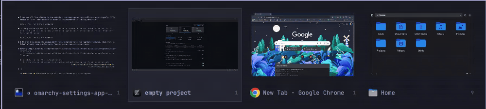

# Omarchy Window Switcher

A macOS- and Windows-style Alt+Tab for [Omarchy](https://omarchy.org): hold Alt and tap Tab
to step through **live previews** of your windows, then let go to switch.



It's an Omarchy shell plugin built from the same components as Omarchy's own overlays, so
it follows your theme, font and corner style.

## Install

```bash
git clone https://github.com/charlesmccarthy/omarchy-switcher ~/code/omarchy-switcher
~/code/omarchy-switcher/install.sh
```

## Use

| Key | Action |
|---|---|
| Alt + Tab | Open the switcher on the previous window; tap Tab again to move on |
| Alt + Shift + Tab, ← → | Move backwards / forwards |
| Release Alt | Switch to the selected window |
| Quick Alt + Tab tap | Jump straight to the previous window, no overlay |
| Click a preview | Switch to it |
| Esc | Cancel |

Windows on every workspace are listed, most recently used first; choosing one on another
workspace takes you there. Floating windows are brought to the front.

## How it works

- `install.sh` copies `plugin/` to `~/.config/omarchy/plugins/omarchy-switcher/`, enables it as
  a shell service (always loaded, so it's instant), and adds one guarded line to
  `~/.config/hypr/bindings.lua` that loads `plugin/bindings.lua`.
- `bindings.lua` replaces Omarchy's Alt+Tab. Each step is appended to a small file in
  `$XDG_RUNTIME_DIR`, which the service streams with `tail -F`; that's several times faster
  than starting an IPC client per key press.
- A switch finishes when Alt is physically released: a 15 ms Hyprland timer checks
  `hl.is_key_down` while a switch is in progress. Release key bindings alone miss quick taps.
- The target window is focused only after the overlay has unmapped, so Hyprland's focus
  restore can't undo the switch.
- Previews come from Quickshell's `ScreencopyView` on Hyprland's toplevels. Windows not drawn
  since the shell started show their app icon instead.
- `plugin/switcher.sh enable | disable | status` turns the bindings on and off; the
  [Omarchy Settings](https://github.com/charlesmccarthy/omarchy-settings) app uses it for its
  Windows → Window switcher toggle. `switcher.sh next` / `commit` drive it by hand for testing.

## Uninstall

```bash
~/code/omarchy-switcher/uninstall.sh
```

This removes the plugin and restores Omarchy's default Alt+Tab.

## License

MIT
